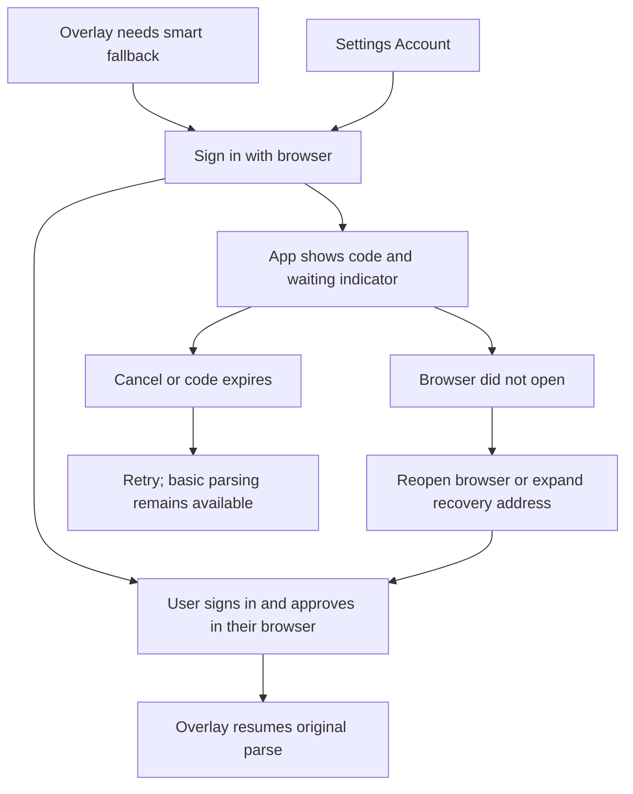
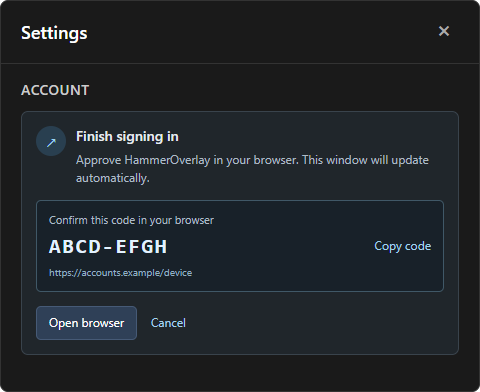
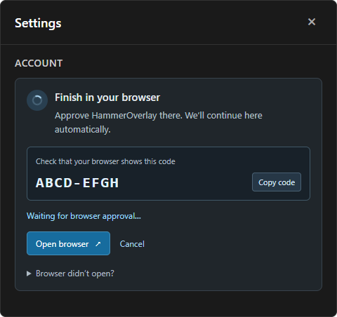
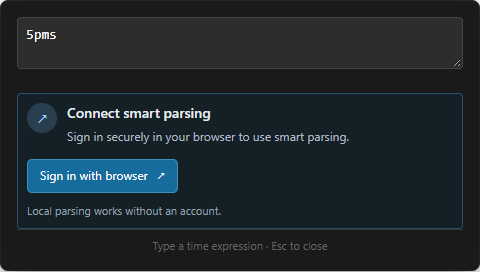
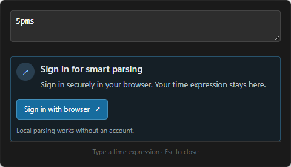
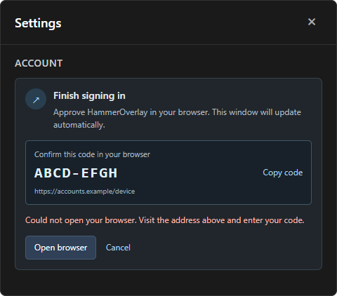
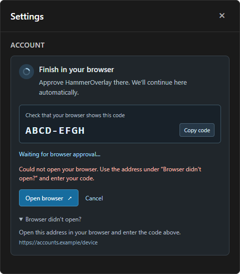

# Sign-in visual review

The account controls now make the browser handoff clearer: an animated waiting indicator shows the app is listening, the confirmation code remains visible, and browser recovery has a separate disclosure. Copy code confirms success. The overlay automatically resumes the original time expression after approval.

These are **React component previews with synthetic authentication states**, captured in headless Chrome on November 19, 2026. They use the actual `HostedAccount` component and application CSS, inside a representative Settings or overlay shell. They do not prove native WebView2 layout, browser approval, provider branding, or credential persistence. No real device codes, account details, or credentials appear in these images.

Windows Computer Use could not initialize: `CreateProcessWithLogonW failed: 32`. The second desktop controller also failed to start. The shared Playwright controller reported its browser profile was already in use. An isolated headless Chrome process captured these previews without touching the user's browser or signed-in app.

## User journey

## Representative comparisons

| State | Before | After |
| --- | --- | --- |
| Settings, waiting |  |  |
| Overlay, signed out |  |  |
| Browser open failure |  |  |

Both directories also include connected and expired-code states for Settings and the overlay, ten images per directory. The waiting fixture uses code `ABCD-EFGH` and `https://accounts.example/device`.

## Checks and remaining captures

- Nineteen related UI/relay tests passed. Account tests cover browser handoff, cancellation, stale responses, expiry, automatic resume, browser-open failure, and copy feedback. The existing delayed-request overlay test remains green.
- Frontend typecheck passed with the existing unused-local exception. Headless capture reported no page errors or horizontal overflow at 480px.
- The earlier real browser sign-in and fallback parse were confirmed by the user. This polish changes presentation, not the authentication protocol.
- Actual native screenshots and the browser's sign-in, approval, and success pages are still missing because desktop capture is unavailable. The human must complete authentication; it must not be automated.
- No installer, release, or merge was performed. Installed-MSI smoke and full live parser qualification remain outside this visual pass.

The local capture harness is `.cache/capture-sign-in.mjs`. It launches a temporary Vite server on loopback port 1437, uses the installed Playwright runtime from basic-life, mocks only the auth/native boundaries, captures each state, then closes its own browser and server. It is a local evidence tool, not a shipped app entry point.
