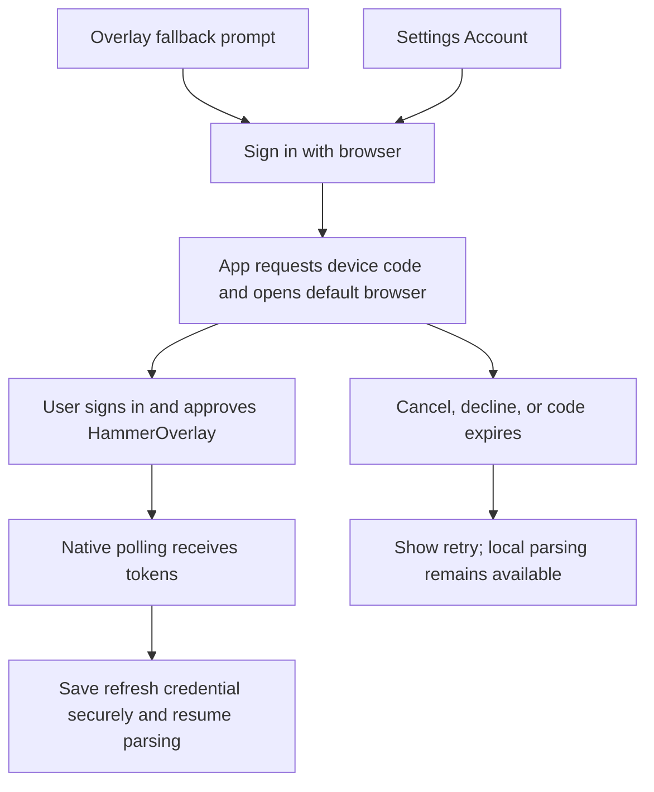
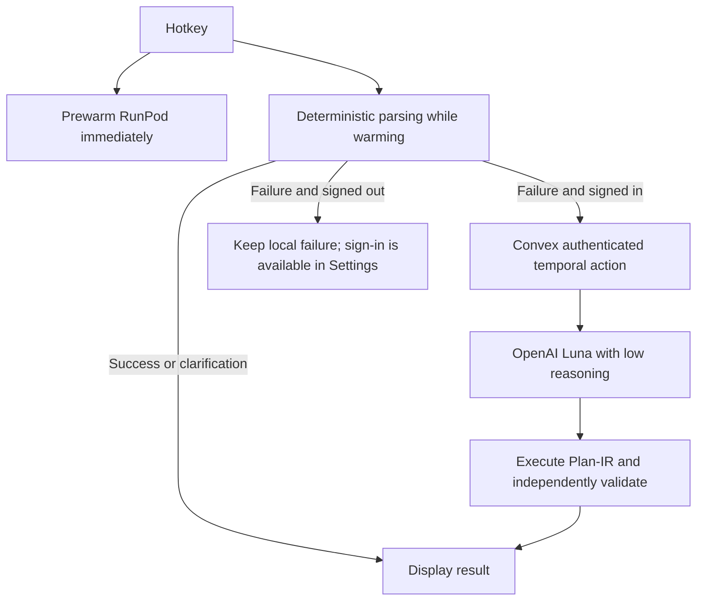

# Temporal fallback relay

HammerOverlay uses Clerk for sign-in and Convex for the authenticated temporal action and usage records. The action calls OpenAI directly with `gpt-6-luna` and low reasoning. No separate gateway, budget ledger, quota service, or user-sync webhook is needed for this version.

This follows the user's decision to keep the relay simple. The earlier Lambda stack and Convex AI Gateway proposals are superseded. Development is deployed; the installed app and release are unchanged.

## What users get

The hotkey immediately prewarms RunPod. While it warms, deterministic parsing runs first. A failure can use the hosted fallback if the user is signed in. Successful deterministic results and clarifications make no fallback call. Every model answer still passes Plan-IR execution and independent validation.

Cloud fallback waits for one second of idle input, discards superseded text before making a request, and is unavailable when the build has no relay URL. Convex's maintained rate-limiter component allows ten calls per minute per identity, with capacity for one immediate call. This bounds rapid repeats without a budget ledger. Client cancellation still cannot cancel work already running in Convex.

Settings and the inline fallback prompt offer Sign in with browser. Clerk's public OAuth device grant opens the default browser, where Google and other configured sign-in methods work. The overlay shows the confirmation code and supports cancellation and retry. Approval automatically resumes the original parse. Local parsing works without an account.

The Windows native process stores the refresh credential in Windows Credential Manager and keeps identity tokens in memory. Restarting silently refreshes the session. Credentials are isolated by app instance and OAuth client. Sign out removes the local credential and requests provider revocation when discovery advertises it. It does not sign the user out of their browser.

### Browser sign-in journey

## Implementation

- One Convex action accepts text, timezone, reference instant, and request ID. Server code fixes the model, prompts, schema, and reasoning. It rejects anonymous requests, invalid timezones, invalid reference times, and oversized input.
- The desktop supplies a short-lived Clerk OIDC identity token with the desktop OAuth client as its audience. Convex verifies its signature, issuer, and audience. The OpenAI key stays in Convex environment variables.
- Reuse the existing parser from `api/src/temporal`. Fastify and SQLite stay local. The relay is a Node action because this parser uses Node packages and APIs.
- An internal mutation records user identity, token counts, latency, input length, and outcome. It does not save temporal input text. Users can query only their own aggregate usage.
- The desktop preserves the reference time across local parsing and fallback, discards cancelled results, and skips redundant post-display LLM verification for server-validated results.
- A 30-second server timeout bounds stalled requests. It is a safety guard, not the five-second product SLO. Client cancellation cannot stop a running Convex action.
- Provider failures log diagnostic name/status without raw prompts or credentials. Usage tracking is best effort and cannot replace a successful parse. Structured auth and throttle failures retain their actionable client messages. Deployment requires both Clerk issuer and OAuth audience configuration.

## Development setup

The current development project is `basic-bit/hammeroverlay`, deployment `effervescent-oyster-428`. The Clerk application is `app_3MJJje32108M4DP1qNgUkspF6wY`, development issuer `https://sterling-griffon-6475.clerk.accounts.dev`. The public HammerOverlay Desktop OAuth client is `XM0ds3RI7HGhMKAo`, with device authorization enabled and scopes `openid offline_access`.

In ignored `.env.local`, set `CONVEX_DEPLOYMENT`, `VITE_CONVEX_URL`, `VITE_CLERK_ISSUER`, and `VITE_CLERK_OAUTH_CLIENT_ID`. The native build reads the issuer and public client ID; CI can supply them through the environment. Native discovery requires HTTPS endpoints on the configured issuer's origin. Private device codes and refresh credentials never cross the webview boundary. The embedded Clerk SDK and transport plugins are removed.

Configure server-only `OPENAI_API_KEY`, `CLERK_JWT_ISSUER_DOMAIN`, and `CLERK_OAUTH_CLIENT_ID` through the Convex dashboard or `npx convex env set`. Never put the OpenAI key in a `VITE_` variable. Deploy development with `npx convex dev --once --typecheck enable`. Run `npm test`, `npm run build:api`, `npm run build`, and `cargo test --manifest-path src-tauri/Cargo.toml --locked hosted_auth::tests`.

For desktop tests of the cloud route, leave the local API's `OPENAI_API_KEY` unset. A locally configured OpenAI key intentionally retains the existing direct fallback path.

## Evidence and remaining acceptance

Checked November 18, 2026:

- Full offline regression suite passed, including warmup, cancellation, and 51/51 reference-routing cases. Relay tests cover authentication, input validation, user isolation, provider failures, signed-out behavior, and cancellation. Frontend production build, API strict build, Convex strict typecheck/deploy, and native compilation passed.
- The standard frontend typecheck still has two pre-existing unused declarations in prompt.ts. It passes with only that existing unused-local check disabled.
- Direct Luna smoke passed `5pm`, `tmrw at seventeen hundred`, and `tomorrow at l33t time`. LLM cases took about 7-10 seconds. A previous Luna miss sent spelled-out words to a literal clock tool. A general tool-contract instruction now directs spelled-out clocks through semantic clock interpretation; no deterministic phrase shim was added. The phrase is preserved as a diagnostic eval.
- A real Clerk JWT for the explicitly approved synthetic test user successfully called the deployed relay for `tmrw at seventeen hundred`. It returned epoch `1795125600`, passed independent validation, recorded 5,268 input and 786 output tokens, and took 13,371 ms end to end. The test session was revoked. One named synthetic user remains for repeat tests.
- Anonymous access to the deployed relay was rejected. This is backend authentication proof, not desktop sign-in proof.
- Actual Tauri sign-in, cross-window auth behavior, and exact installed-MSI smoke are NOT RUN. Required full live model evals and the five-second latency target remain open. No installer, parser-default promotion, or release was made.

November 19 follow-up: the local signed-out path silently returned null, which left the deterministic error on screen. It now returns an explicit sign-in error and the overlay offers a Sign in button that opens Settings. Settings remains selected when the window regains focus. The local smoke executable was rebuilt and restarted; desktop control is unavailable because its helper cannot start, so actual user sign-in is still pending.

Luna correctly interpreted `5pm` and `5pms`, but initially emitted a clock-only final step rather than a dated candidate. The planner now documents the operation output types and delegates omitted-date anchoring to the existing calendar-query operation. A six-case Luna-only diagnostic passed with independent validation: `5pm`, `5pms`, `7pms`, `17:00`, `tomorrow at 5pm`, and `tmrw at seventeen hundred`. The negative controls preserved clarification for `5` and failure for nonsense. A subsequent real Clerk JWT request to the deployed relay resolved `5pms` to epoch `1795125600` at the fixed November 19 reference time. This fixes the Luna planner contract; the RunPod V22 adapter is unchanged.

November 19 user verification: the user confirmed browser sign-in worked and supplied a screenshot of the local overlay resolving `5pms` to 5 PM. The waiting screenshot exposed a separate UI issue: the warmup notice suppressed active parsing progress. The overlay now gives active progress priority, identifies the smart fallback with a note that it may take a few seconds, and hides warmup messaging once a result is displayed. A delayed-request component regression verifies progress remains visible beyond six seconds and clears on completion. All 18 related UI/relay tests passed, along with the frontend typecheck using the existing unused-local exception and the local desktop build. Real-account persistence after restart and native inspection of this progress change remain unverified.

## References

The [full Luna qualification](handoffs/2026-11-19-luna-qualification.md) failed at 148/202 required cases, with all failures preserved. CI passing and the successful standalone-clock diagnostics do not qualify this parser default for promotion. Exact installed-MSI authentication acceptance also remains open after the review install was canceled.

The [sign-in visual review](screenshots/sign-in/README.md) contains before/after component previews, capture provenance, and the remaining native/browser capture gap. The visual polish adds an animated approval indicator, clearer handoff copy, copy confirmation, and an expandable recovery address. Authentication behavior is unchanged.

November 19 browser-flow replacement: the embedded Google login could stall in WebView2. It is replaced by the supported Clerk device grant and default-browser approval. The public client and live device-authorization endpoint were verified, and the development Convex audience configuration was deployed. The full offline suite, strict API build, frontend build, frontend typecheck with the existing unused-local exception, native compilation, and four native auth tests passed. Five account UI tests cover browser handoff, cancellation, late responses, expiry, automatic resume, and browser-open failure. A temporary synthetic Windows credential was restored from a fresh native state and deleted. Real browser approval, a real account's refresh after restart, and actual native visual inspection remain pending. No installer or release was created.

- [Clerk and Convex authentication](https://docs.convex.dev/auth/clerk)
- [Clerk device authorization grant](https://clerk.com/docs/guides/configure/auth-strategies/oauth/device-authorization-grant)
- [Convex actions](https://docs.convex.dev/functions/actions)
