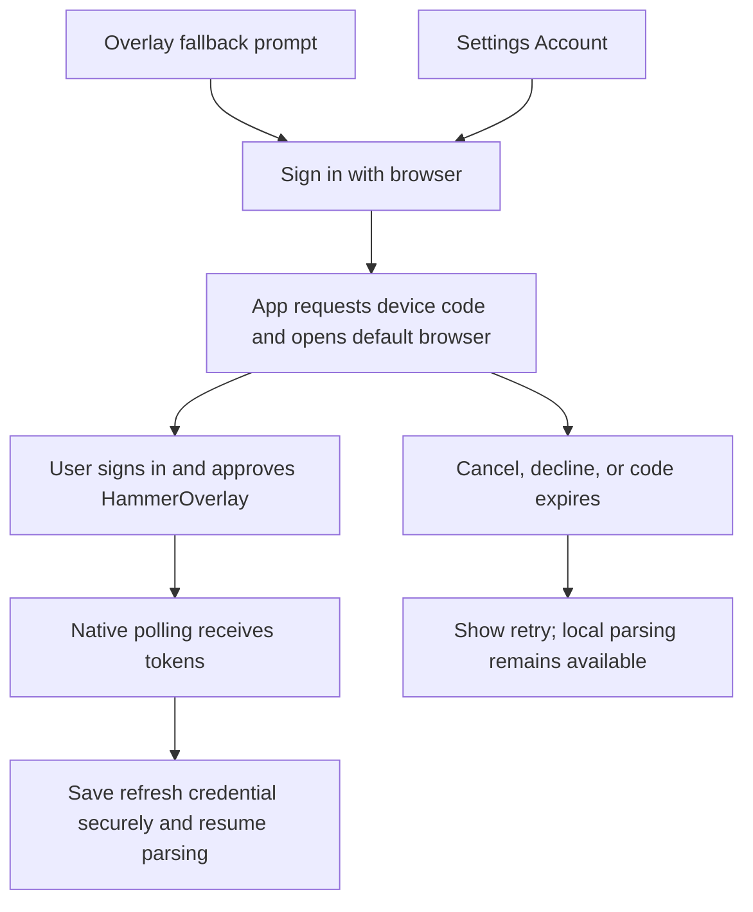
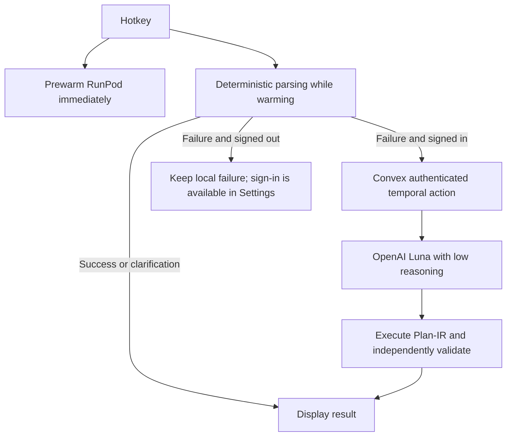

# Temporal fallback relay

HammerOverlay uses Clerk for sign-in and Convex for the authenticated temporal action and usage records. The action calls OpenAI directly with `gpt-6-luna` and low reasoning. No separate gateway, budget ledger, quota service, or user-sync webhook is needed for this version.

This follows the user's decision to keep the relay simple. The earlier Lambda stack and Convex AI Gateway proposals are superseded. Development is deployed; the installed app and release are unchanged.

## What users get

The hotkey immediately prewarms RunPod. While it warms, deterministic parsing runs first. A failure can use the hosted fallback if the user is signed in. Successful deterministic results and clarifications make no fallback call. Every model answer still passes Plan-IR execution and independent validation.

Cloud fallback waits for at least one second of idle input, discards superseded text before making a request, and is unavailable when the build has no relay URL. Convex's maintained rate-limiter component allows ten calls per minute per identity, with capacity for three immediate calls so an early prefix cannot consume the only token. Throttle and outage states retain the local diagnosis and offer an explicit retry. This bounds rapid repeats without a budget ledger. Client cancellation still cannot cancel work already running in Convex.

Settings and the inline fallback prompt offer Sign in with browser. Clerk's public OAuth device grant opens the default browser, where Google and other configured sign-in methods work. The overlay shows the confirmation code and supports cancellation and retry. Approval automatically resumes the original parse. Local parsing works without an account.

The Windows native process stores the refresh credential in Windows Credential Manager and keeps identity tokens in memory. Restarting silently refreshes the session. Credentials are isolated by app instance and OAuth client. Sign out removes the local credential and requests provider revocation when discovery advertises it. It does not sign the user out of their browser.

### Browser sign-in journey

## Implementation

- One Convex action accepts text, timezone, reference instant, and request ID. Server code fixes the model, prompts, schema, and reasoning. It rejects anonymous requests, invalid timezones, invalid reference times, and oversized input.
- The desktop supplies a short-lived Clerk OIDC identity token with the desktop OAuth client as its audience. Convex verifies its signature, issuer, and audience. The OpenAI key stays in Convex environment variables.
- Reuse the existing parser from `api/src/temporal`. Fastify and SQLite stay local. The relay is a Node action because this parser uses Node packages and APIs.
- An internal mutation records user identity, token counts, latency, input length, and outcome. It does not save temporal input text. Users can query only their own aggregate usage.
- The desktop preserves the reference time across local parsing and fallback, discards cancelled results, and skips redundant post-display LLM verification for server-validated results.
- A 30-second server timeout bounds stalled requests. It is a safety guard, not the five-second product SLO. Client cancellation cannot stop a running Convex action.
- Provider failures log diagnostic name/status without raw prompts or credentials. Usage tracking is best effort and cannot replace a successful parse. Structured auth and throttle failures retain their actionable client messages. Deployment requires both Clerk issuer and OAuth audience configuration.
- A failed executable OpenAI plan can receive one repair attempt with its tool error and prior plan. Semantic rejection, no-plan, and provider errors are not automatically retried. Both attempts remain in diagnostics and token totals; repaired answers still require independent validation. Rejected deterministic preflight validation is also included in usage totals. This can increase fallback latency.
- Auto-loaded clipboard text requires an explicit smart-parsing action before this client uses the hosted relay. Editing the text also establishes intent. Already signed-in account panels do not trigger a new parse merely by mounting.
- Planner and final semantic validation use separate calls to the same Luna model, alongside deterministic schema/executor checks. No claim of consensus between different models is made.
- Clipboard preload remains off if its saved preference cannot be loaded, so a settings failure cannot override a user's disabled preference. This is deliberate; it does not change the Rust default for a new profile.

## Development setup

The current development project is `basic-bit/hammeroverlay`, deployment `effervescent-oyster-428`. The Clerk application is `app_3MJJje32108M4DP1qNgUkspF6wY`, development issuer `https://sterling-griffon-6475.clerk.accounts.dev`. The public HammerOverlay Desktop OAuth client is `XM0ds3RI7HGhMKAo`, with device authorization enabled and scopes `openid offline_access`.

In ignored `.env.local`, set `CONVEX_DEPLOYMENT`, `VITE_CONVEX_URL`, `VITE_CLERK_ISSUER`, and `VITE_CLERK_OAUTH_CLIENT_ID`. The native build reads the issuer and public client ID; CI can supply them through the environment. Native discovery requires HTTPS endpoints on the configured issuer's origin. Private device codes and refresh credentials never cross the webview boundary. The embedded Clerk SDK and transport plugins are removed.

Configure server-only `OPENAI_API_KEY`, `CLERK_JWT_ISSUER_DOMAIN`, and `CLERK_OAUTH_CLIENT_ID` through the Convex dashboard or `npx convex env set`. Never put the OpenAI key in a `VITE_` variable. Deploy development with `npx convex dev --once --typecheck enable`. Run `npm test`, `npm run build:api`, `npm run build`, and `cargo test --manifest-path src-tauri/Cargo.toml --locked hosted_auth::tests`.

For desktop tests of the cloud route, leave the local API's `OPENAI_API_KEY` unset. A locally configured OpenAI key intentionally retains the existing direct fallback path.

## Evidence and remaining acceptance

Checked November 19, 2026:

- The full offline suite passes, including cancellation, fake-provider warmup, validation rejection/repair, and 51/51 reference-routing cases. All 35 related frontend and relay tests pass. API, frontend, and Convex strict typechecks pass, and the frontend production build passes without exceptions for unused declarations.
- Earlier native validation passed compilation, 66 Rust tests, clippy, formatting, and four auth-specific tests. A synthetic Windows credential survived a fresh native state and was deleted. These tests do not prove installed-app authentication.
- The explicitly approved synthetic Clerk user called the deployed relay successfully with a real JWT. Anonymous requests were rejected. The successful request took 13,371 ms and recorded 5,268 input and 786 output tokens. Its test session was revoked. The named synthetic user remains available for repeat tests.
- The user confirmed default-browser sign-in and a local-overlay result resolving 5pms to 5 PM. Real-account refresh after restart, cross-window behavior, and exact installed-MSI acceptance remain unverified. The previous MSI install was canceled; it was not accepted as installed proof.
- The [sign-in previews](screenshots/sign-in/README.md) show actual React/CSS with synthetic auth states, including waiting, expiry, retry, and code-copy confirmation. They are component previews, not screenshots of native Windows or Clerk's browser approval page. Desktop automation is currently unavailable.
- Active fallback progress takes priority over the background warmup notice and remains visible during delayed requests. A successful result hides the warmup notice. Browser approval restores the initiating overlay's always-on-top state and focus without reopening it or resetting its text; cancellation and browser-open failure also restore its window state.
- The [initial full Luna qualification](handoffs/2026-11-19-luna-qualification.md) failed at 148/202 required cases. A subsequent complete research run reached 200/202, with both mismatches confined to display format. The exact 8ecdbf1 head also scored 200/202 required and 4/5 diagnostic. Its remaining required failures were a false holiday-calendar rejection and an overwritten clock dependency. A bounded plan-repair follow-up is under qualification. No expected answers were changed. The model-only comparison failed at 131/202, so deterministic preflight remains enabled.
- Live fallback requests still exceed the five-second SLO on harder expressions. A passing correctness suite does not establish latency qualification. Cost estimates in the eval are unconfigured; zero is not a measured dollar cost.

Development Clerk and Convex configuration is deployed. The latest research changes have not been promoted to the deployed relay. No Windows release has been made, and this PR is not merge-ready until required qualification, current-head checks/review, and installed-MSI acceptance are complete.

## References

- [Clerk and Convex authentication](https://docs.convex.dev/auth/clerk)
- [Clerk device authorization grant](https://clerk.com/docs/guides/configure/auth-strategies/oauth/device-authorization-grant)
- [Convex actions](https://docs.convex.dev/functions/actions)
