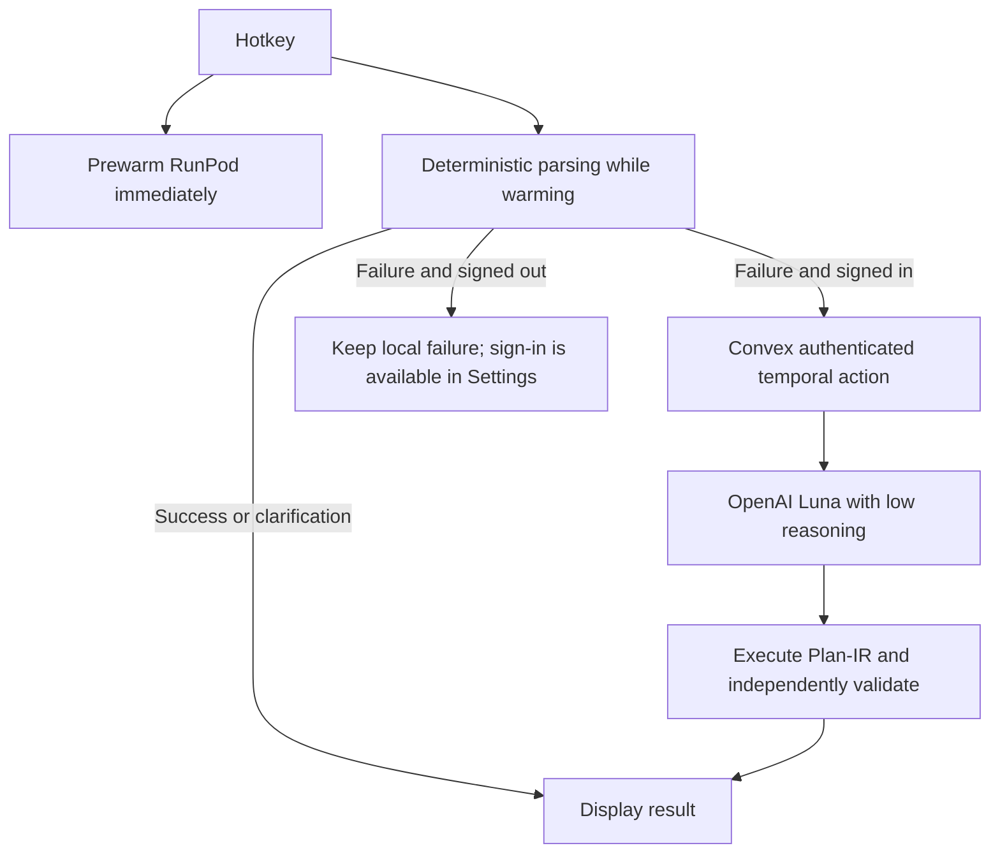

# Temporal fallback relay

HammerOverlay uses Clerk for sign-in and Convex for the authenticated temporal action and usage records. The action calls OpenAI directly with `gpt-6-luna` and low reasoning. No separate gateway, budget ledger, quota service, or user-sync webhook is needed for this version.

This follows the user's decision to keep the relay simple. The earlier Lambda stack and Convex AI Gateway proposals are superseded. Development is deployed; the installed app and release are unchanged.

## What users get

The hotkey immediately prewarms RunPod. While it warms, deterministic parsing runs first. A failure can use the hosted fallback if the user is signed in. Successful deterministic results and clarifications make no fallback call. Every model answer still passes Plan-IR execution and independent validation.

Settings includes sign-in and sign-out. Local parsing works without an account. Native email-code sign-in is supported by the Clerk Tauri integration. Its default UI does not support OAuth or magic links.

Sessions currently last until app exit. The plugin's optional plaintext credential store is disabled. Persistent sign-in needs an encrypted store later.

## Implementation

- One Convex action accepts text, timezone, reference instant, and request ID. Server code fixes the model, prompts, schema, and reasoning. It rejects anonymous requests, invalid timezones, invalid reference times, and oversized input.
- The desktop supplies a short-lived Clerk JWT with audience `convex`. The OpenAI key stays in Convex environment variables.
- Reuse the existing parser from `api/src/temporal`. Fastify and SQLite stay local. The relay is a Node action because this parser uses Node packages and APIs.
- An internal mutation records user identity, token counts, latency, input length, and outcome. It does not save temporal input text. Users can query only their own aggregate usage.
- The desktop preserves the reference time across local parsing and fallback, discards cancelled results, and skips redundant post-display LLM verification for server-validated results.
- A 30-second server timeout bounds stalled requests. It is a safety guard, not the five-second product SLO. Client cancellation cannot stop a running Convex action.

## Development setup

The current development project is `basic-bit/hammeroverlay`, deployment `effervescent-oyster-428`. The Clerk application is `app_3MJJje32108M4DP1qNgUkspF6wY`, development issuer `https://sterling-griffon-6475.clerk.accounts.dev`. Native API is already enabled. The `convex` JWT template has `aud: convex` and a 60-second lifetime.

In ignored `.env.local`, set `CONVEX_DEPLOYMENT`, `VITE_CONVEX_URL`, and `VITE_CLERK_PUBLISHABLE_KEY`. The native build reads the same local publishable key; CI can supply it through the environment. The native HTTP capability permits only the configured Clerk development host. Update that capability when changing the issuer.

Configure server-only `OPENAI_API_KEY` and `CLERK_JWT_ISSUER_DOMAIN` through the Convex dashboard or `npx convex env set`. Never put the OpenAI key in a `VITE_` variable. Deploy development with `npx convex dev --once --typecheck enable`. Run `npm test`, `npm run build:api`, `npm run build`, and `cargo check --manifest-path src-tauri/Cargo.toml --locked`.

For desktop tests of the cloud route, leave the local API's `OPENAI_API_KEY` unset. A locally configured OpenAI key intentionally retains the existing direct fallback path.

## Evidence and remaining acceptance

Checked November 18, 2026:

- Full offline regression suite passed, including warmup, cancellation, and 51/51 reference-routing cases. Relay tests cover authentication, input validation, user isolation, provider failures, signed-out behavior, and cancellation. Frontend production build, API strict build, Convex strict typecheck/deploy, and native compilation passed.
- The standard frontend typecheck still has two pre-existing unused declarations in prompt.ts. It passes with only that existing unused-local check disabled.
- Direct Luna smoke passed `5pm`, `tmrw at seventeen hundred`, and `tomorrow at l33t time`. LLM cases took about 7-10 seconds. A previous Luna miss sent spelled-out words to a literal clock tool. A general tool-contract instruction now directs spelled-out clocks through semantic clock interpretation; no deterministic phrase shim was added. The phrase is preserved as a diagnostic eval.
- A real Clerk JWT for the explicitly approved synthetic test user successfully called the deployed relay for `tmrw at seventeen hundred`. It returned epoch `1795125600`, passed independent validation, recorded 5,268 input and 786 output tokens, and took 13,371 ms end to end. The test session was revoked. One named synthetic user remains for repeat tests.
- Anonymous access to the deployed relay was rejected. This is backend authentication proof, not desktop sign-in proof.
- Actual Tauri sign-in, cross-window auth behavior, and exact installed-MSI smoke are NOT RUN. Required full live model evals and the five-second latency target remain open. No installer, parser-default promotion, or release was made.

November 19 follow-up: the local signed-out path silently returned null, which left the deterministic error on screen. It now returns an explicit sign-in error and the overlay offers a Sign in button that opens Settings. Settings remains selected when the window regains focus. The local smoke executable was rebuilt and restarted; desktop control is unavailable because its helper cannot start, so actual user sign-in is still pending.

Luna correctly interpreted `5pm` and `5pms`, but initially emitted a clock-only final step rather than a dated candidate. The planner now documents the operation output types and delegates omitted-date anchoring to the existing calendar-query operation. A six-case Luna-only diagnostic passed with independent validation: `5pm`, `5pms`, `7pms`, `17:00`, `tomorrow at 5pm`, and `tmrw at seventeen hundred`. The negative controls preserved clarification for `5` and failure for nonsense. A subsequent real Clerk JWT request to the deployed relay resolved `5pms` to epoch `1795125600` at the fixed November 19 reference time. This fixes the Luna planner contract; the RunPod V22 adapter is unchanged.

## References

- [Clerk and Convex authentication](https://docs.convex.dev/auth/clerk)
- [Clerk Tauri integration and limitations](https://github.com/Nipsuli/tauri-plugin-clerk)
- [Convex actions](https://docs.convex.dev/functions/actions)
